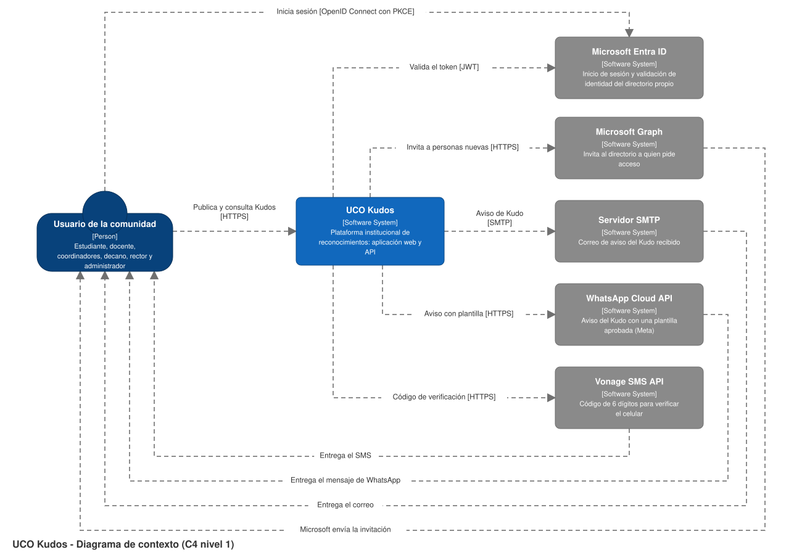
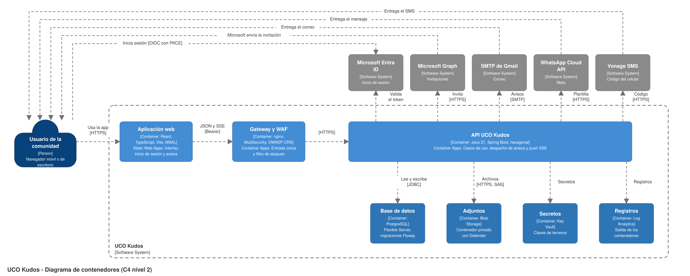
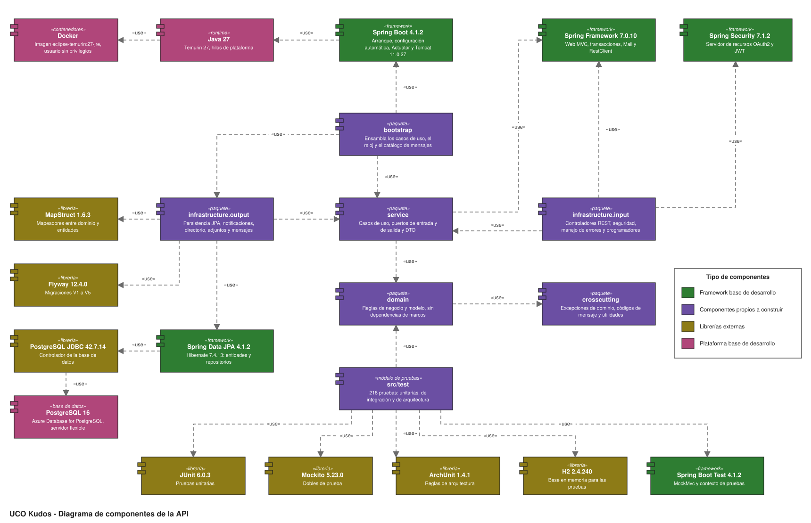
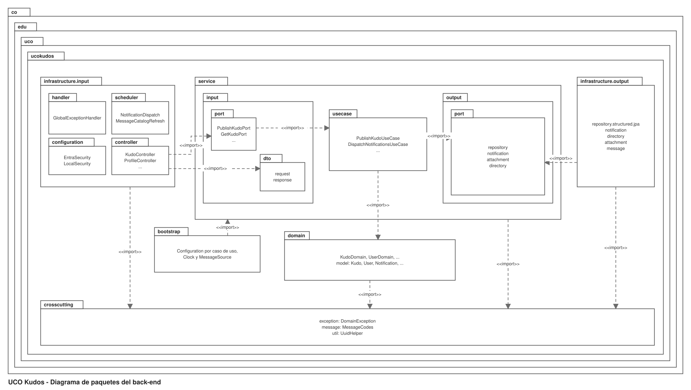

# UCO Kudos: API

API de **UCO Kudos**, una plataforma institucional de reconocimientos: un estudiante, un docente o un directivo le envía a otra persona de la comunidad un mensaje de aprecio (un *Kudo*) y el destinatario se entera por correo, WhatsApp y una notificación en tiempo real.

- **Sitio publicado:** https://kudos.ucokudos.qd.je
- **Aplicación web:** repositorio [front-kudos](https://github.com/Andruortiz/front-kudos)
- **Calidad:** [SonarCloud](https://sonarcloud.io/summary/new_code?id=Andruortiz_UcoKudos)

## Qué hace

| Funcionalidad | Estado |
|---|---|
| Publicar un Kudo con idempotencia, límite diario y reglas de quién puede enviar a quién | Construida |
| Adjuntos (imágenes y PDF) guardados en Azure Blob Storage, con descarga solo para el autor y el destinatario | Construida |
| Avisos por correo, WhatsApp y *push* en tiempo real (SSE), con bandeja de salida, reintentos y estado por canal | Construida |
| Inicio de sesión con Microsoft Entra ID y alta automática mediante una invitación de Microsoft Graph | Construida |
| Verificación del celular con un código por SMS (Vonage); sin celular verificado no se pueden enviar Kudos | Construida |
| Auditoría de las acciones principales | Construida (sin consulta para el administrador) |
| Réplicas y calificaciones, aprobaciones jerárquicas, administración de usuarios, observabilidad | **Sin construir** |

El estado completo frente a la guía del trabajo está en [Documentacion](Documentacion/).

## Arquitectura

La API es **un solo servicio** con arquitectura hexagonal (puertos y adaptadores). La regla de dependencia apunta hacia adentro y la verifica ArchUnit en cada ejecución de las pruebas.

### Contexto del sistema



### Contenedores



### Componentes de la API



### Paquetes



Los diagramas también están como archivos `.drawio` editables en la misma carpeta (se abren con [diagrams.net](https://app.diagrams.net)).

## Tecnologías

| Pieza | Tecnología |
|---|---|
| Lenguaje y marco | Java 27, Spring Boot 4.1.2, Spring Web MVC, Spring Security (servidor de recursos OAuth2 con JWT) |
| Persistencia | PostgreSQL, Spring Data JPA con Hibernate, migraciones con Flyway, mapeadores con MapStruct |
| Integraciones | Microsoft Entra ID y Graph, SMTP, WhatsApp Cloud API (Meta), Vonage SMS, Azure Blob Storage |
| Pruebas | JUnit, Mockito, Spring Boot Test, ArchUnit, H2 |
| Entrega | Docker, GitHub Actions, SonarCloud, Trivy, Azure Container Apps |

## Ejecutar en local

Requisitos: JDK 27, Docker y Git. No hace falta instalar Maven: el repositorio trae `./mvnw`.

**1. Base de datos y correo de desarrollo**

```bash
docker run -d --name kudos-db -e POSTGRES_DB=kudos -e POSTGRES_USER=kudos -e POSTGRES_PASSWORD=kudos -p 5432:5432 postgres:17
```

```bash
docker run -d --name mailpit -p 1025:1025 -p 8025:8025 axllent/mailpit
```

Mailpit recibe los correos que envía la API y los muestra en http://localhost:8025, sin enviar nada real.

**2. La API**, con la autenticación de desarrollo (identifica al usuario por la cabecera `X-Dev-User`, sin iniciar sesión con Microsoft):

```bash
KUDOS_DEV_AUTH_ENABLED=true ./mvnw spring-boot:run
```

En PowerShell: `$env:KUDOS_DEV_AUTH_ENABLED = "true"; ./mvnw spring-boot:run`

Comprueba que responde en http://localhost:8080/actuator/health. El perfil `local` aplica las migraciones y además crea las categorías y tres usuarios de prueba: Ana (estudiante), Luis (docente) y Carlos (estudiante). Los adjuntos se guardan en memoria.

El manual completo, con las variables de entorno, la configuración de Microsoft Entra y la validación del flujo Publicar Kudo, está en [manual-de-puesta-a-punto.md](Documentacion/manual-de-puesta-a-punto.md).

## Pruebas

```bash
./mvnw test
```

Son 218 pruebas: unitarias, de integración (con H2) y 11 reglas de arquitectura con ArchUnit. ArchUnit 1.4.1 no lee clases de Java 27, así que el build compila además una copia con nivel 25 que solo usan esas reglas; el código que se despliega sigue compilado con Java 27.

La validación de las migraciones sobre un PostgreSQL real existe, pero solo corre si se define la variable `FLYWAY_CHECK_DB_URL` y no está en el CI:

```bash
FLYWAY_CHECK_DB_URL=jdbc:postgresql://localhost:5432/kudos_check ./mvnw test -Dtest=FlywayMigrationsTest
```

## Configuración

Cada propiedad de `application.properties` se puede sobrescribir con una variable de entorno. **Los secretos nunca van en el repositorio.** Las más importantes en producción:

| Variable | Función |
|---|---|
| `SPRING_PROFILES_ACTIVE` | Un valor distinto de `local` (por ejemplo `prod`); sin él se aplicarían los valores de desarrollo |
| `SPRING_DATASOURCE_URL`, `SPRING_DATASOURCE_USERNAME`, `SPRING_DATASOURCE_PASSWORD` | Conexión a PostgreSQL |
| `KUDOS_DISPATCH_ENABLED` | Con valor `true` enciende el envío de avisos; apagado, ningún aviso sale |
| `KUDOS_CORS_ALLOWED_ORIGINS` | Origen de la aplicación web |
| `SPRING_MAIL_*` y `MAIL_FROM` | Servidor SMTP |
| `KUDOS_WHATSAPP_TOKEN`, `KUDOS_WHATSAPP_PHONE_NUMBER_ID` | Activan el canal de WhatsApp |
| `KUDOS_VONAGE_API_KEY`, `KUDOS_VONAGE_API_SECRET` | SMS del código del celular |
| `KUDOS_GRAPH_CLIENT_ID`, `KUDOS_GRAPH_CLIENT_SECRET` | Invitaciones de Microsoft Graph |
| `KUDOS_ATTACHMENTS_STORAGE`, `KUDOS_ATTACHMENTS_CONTAINER_URL`, `KUDOS_ATTACHMENTS_SAS` | Almacenamiento de adjuntos (`azure` o `memory`) |

## Integración y despliegue continuos

El flujo `.github/workflows/ci-cd.yml` hace, en cada pull request y en cada push a `master`:

1. **Compilar y probar** con `./mvnw verify`, analizar con **SonarCloud** y escanear dependencias y secretos con **Trivy**.
2. **Imagen:** en `master`, construir la imagen, escanearla con Trivy y publicarla en GitHub Container Registry, etiquetada con el SHA del commit.
3. **Despliegue:** en `master`, desplegar esa imagen en Azure Container Apps. Inicia sesión en Azure con OIDC, sin guardar contraseñas, con un permiso limitado a la aplicación.

Delante de la API hay un gateway con WAF (nginx, ModSecurity y reglas OWASP CRS) que es la entrada pública.

## Documentación

| Documento | Contenido |
|---|---|
| [Adrs](Documentacion/Adrs/) | Las decisiones de arquitectura, con sus alternativas, costos con precio oficial y registro de cambios |
| [manual-de-puesta-a-punto.md](Documentacion/manual-de-puesta-a-punto.md) | Instalación, configuración, pruebas, despliegue y validación |
| [drivers-arquitectonicos-ucokudos.md](Documentacion/drivers-arquitectonicos-ucokudos.md) | Drivers arquitectónicos |
| [r-tecnicas-negocio-funcionalidades.md](Documentacion/r-tecnicas-negocio-funcionalidades.md) | Restricciones técnicas, reglas de negocio y funcionalidades |
| [tradeoff-calidad-ucokudos.md](Documentacion/tradeoff-calidad-ucokudos.md) | Atributos de calidad, escenarios y trade-offs |
